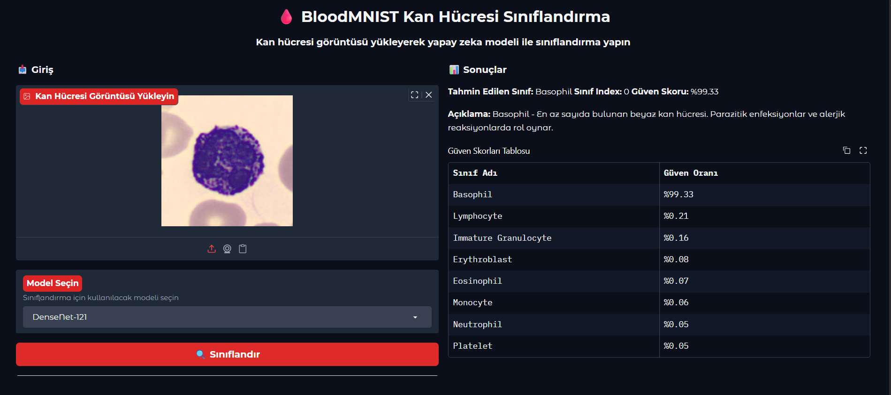
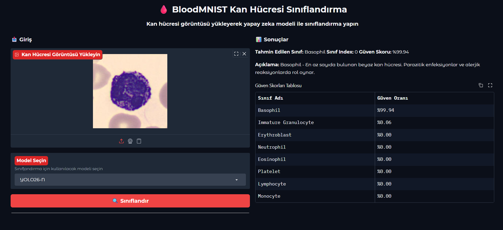
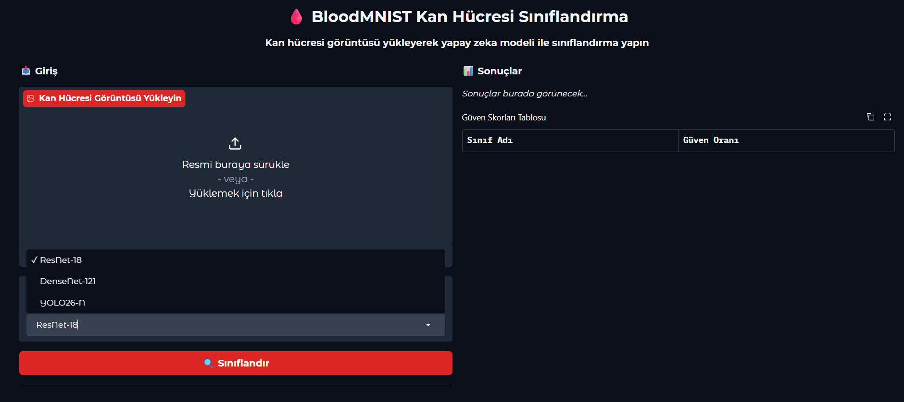
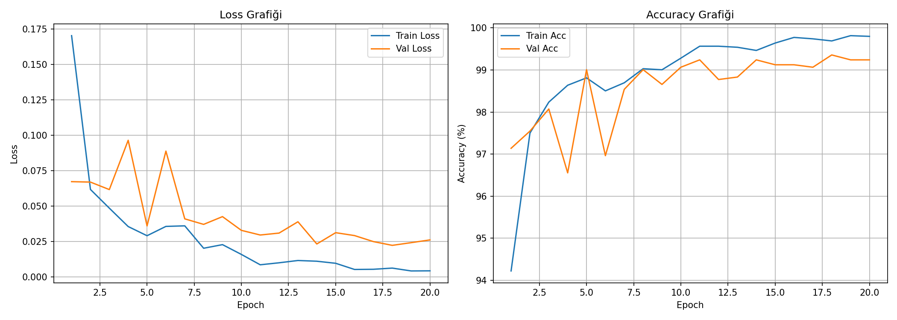
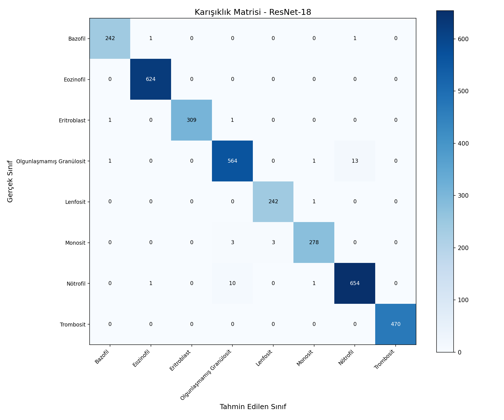
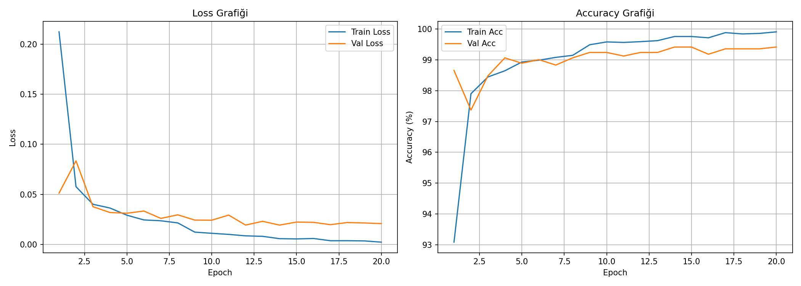
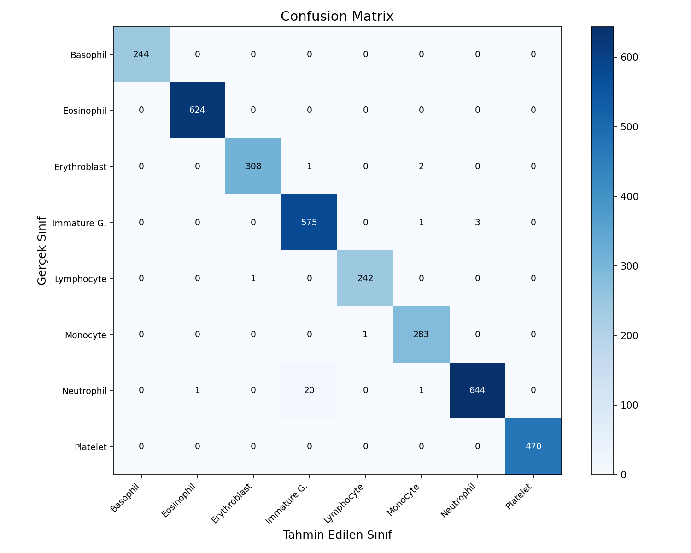
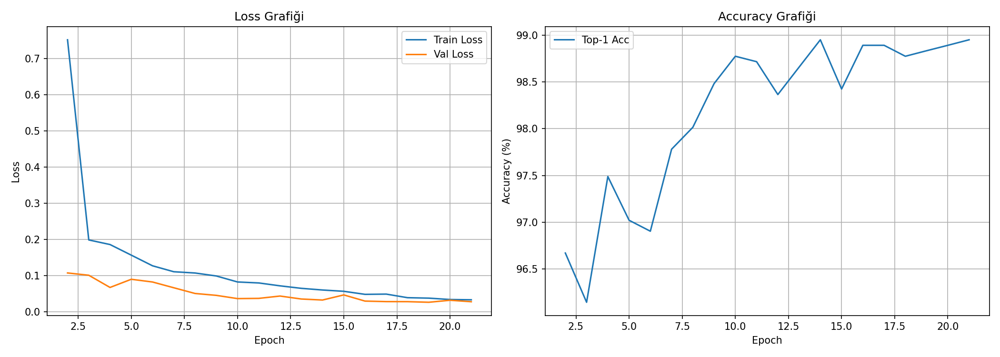
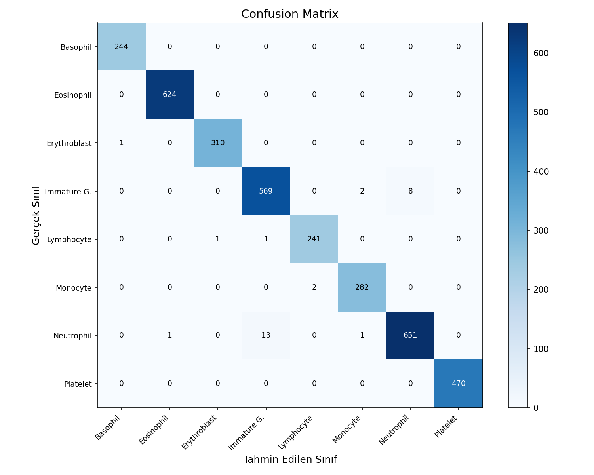

# BloodMNIST Kan Hücresi Sınıflandırma

BloodMNIST mikroskop görüntülerini sekiz kan hücresi sınıfından birine ayıran, model eğitimi ve değerlendirme betikleri ile Gradio tabanlı demo arayüzü içeren proje.

## Modeller ve sınıflar

Arayüzden şu modeller seçilebilir:

- ResNet-18
- DenseNet-121
- YOLO26-N sınıflandırma

Sınıflar: Basophil, Eosinophil, Erythroblast, Immature Granulocyte, Lymphocyte, Monocyte, Neutrophil ve Platelet.

## Gereksinimler

- Python 3.9 veya üstü
- `requirements.txt` içindeki Python paketleri
- Eğitim ve demo çalıştırmak için yeterli disk alanı. Projede bulunan `bloodmnist_224.npz` yaklaşık 1,54 GB boyutundadır.

Bağımlılıkları kurun:

```bash
python -m venv .venv
# Windows:
.venv\Scripts\activate
# macOS/Linux:
source .venv/bin/activate

python -m pip install --upgrade pip
pip install -r requirements.txt
```

PyTorch kurulumunu makinenize uygun CPU/CUDA seçeneğiyle yapmak gerekebilir; ayrıntılar için [PyTorch kurulum sayfasına](https://pytorch.org/get-started/locally/) bakın.

## Demo arayüzünü çalıştırma

Depodaki eğitilmiş ağırlık dosyaları yerindeyse:

```bash
python app.py
```

Arayüz `http://localhost:7860` adresinde açılır. Bir kan hücresi görüntüsü yükleyin ve modeli seçin. Uygulama tahmin edilen sınıfı ve sekiz sınıf için güven skorlarını gösterir. Görüntü yüklendiğinde tahmin otomatik olarak da çalışır.

Demo şu ağırlık dosyalarını bekler:

| Model | Beklenen dosya |
|---|---|
| ResNet-18 | `resnet-18/checkpoints/best_model.pth` |
| DenseNet-121 | `densenet121/checkpoints/best_model.pth` |
| YOLO26-N | `yolo26/checkpoints/best_model.pt` |

## Veri hazırlama

`split.py`, kök dizindeki `bloodmnist_224.npz` dosyasından `bloodmnist_split/` klasör yapısını oluşturur. NPZ dosyasının `train_images`, `train_labels`, `val_images`, `val_labels`, `test_images` ve `test_labels` dizilerini içermesi beklenir.

```bash
python split.py
```

Oluşturulan yapı:

```text
bloodmnist_split/
├── train/<sınıf-indeksi>/
├── val/<sınıf-indeksi>/
└── test/<sınıf-indeksi>/
```

Her sınıf klasöründe o sınıfa ait PNG görüntüleri bulunur. `split.py` mevcut dosyaların üzerine yazabilir; veri hazırlığını tekrar çalıştırmadan önce yeterli disk alanı olduğundan emin olun.

## Eğitim ve değerlendirme

Depodaki model klasörleri kendi eğitim betiklerini içerir. Eğitim betiklerini ilgili klasörden çalıştırın; veri yolu yapılandırmasını betikteki `DATA_DIR` ayarıyla eşleşecek şekilde düzenleyin. Eğitim betikleri `checkpoints/` altına en iyi ve son ağırlıkları, ayrıca eğitim metriklerini/grafiklerini kaydeder.

Kök dizindeki `train.py`, `bloodmnist_split` verisini kullanarak Ultralytics YOLO26-N sınıflandırma modelini eğitir. Bu betik ağırlıkları kökteki `checkpoints/` klasörüne kopyalar; demo ise bunları `yolo26/checkpoints/` altında arar. Demo ile kullanmak için en iyi ağırlığı beklenen konuma kopyalayın:

```powershell
Copy-Item checkpoints/best_model.pt yolo26/checkpoints/best_model.pt
```

Değerlendirme betikleri test kümesi üzerinde sınıflandırma raporu ve karışıklık matrisi üretir:

```bash
python evaluate_resnet18.py
```

YOLO değerlendirme betiği `evaluate.py` dosyasıdır ve `checkpoints/best_model.pt` bekler. Diğer modellerin eğitim ve değerlendirme betiklerini kendi dizinlerinde bulabilirsiniz.

## Proje yapısı

```text
app.py                  Gradio tahmin arayüzü
split.py                NPZ veri kümesini klasörlere ayırma
train.py                YOLO26-N sınıflandırma eğitimi
evaluate*.py            Test kümesi değerlendirmeleri
bloodmnist_split/        Train/validation/test görüntüleri
resnet-18/               ResNet-18 ağırlıkları ve çıktıları
densenet121/             DenseNet-121 ağırlıkları ve çıktıları
yolo26/                  YOLO26 ağırlıkları ve çıktıları
requirements.txt         Python bağımlılıkları
```

## Görseller ve sonuçlar

Projedeki karşılaştırma grafikleri ve örnek görüntüler:

| Model karşılaştırması | Test kümesi performansı |
|---|---|
|  |  |

### Örnek test görüntüleri

   

### Eğitim ve sınıflandırma grafikleri

Bu grafikler depodaki eğitim çalıştırmalarının kayıp/doğruluk eğrileri ve test karışıklık matrisleridir.

| Model | Eğitim eğrileri | Karışıklık matrisi |
|---|---|---|
| ResNet-18 |  |  |
| DenseNet-121 |  |  |
| YOLO26-N |  |  |

## Not

Bu proje eğitim ve araştırma amaçlı bir görüntü sınıflandırma demosudur. Model çıktıları tıbbi tanı veya klinik karar amacıyla kullanılmamalıdır.
